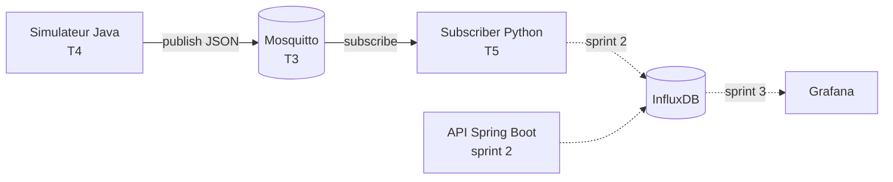

# Système de gestion d'objets IoT (MQTT et Cloud)

Sprint 1 : un circuit complet **simulateur Java → Mosquitto → subscriber Python**.

## Architecture (T2)



Le format des topics et des messages est décrit dans [CONTRAT.md](CONTRAT.md).

## Prérequis

- Docker et Docker Compose
- Java 17+ et Maven
- Python 3.10+

## Lancer le sprint 1

Ouvrir trois terminaux à la racine du projet.

**1. Broker (T3)**

```bash
docker compose up -d
docker compose logs -f mosquitto
```

**2. Subscriber (T5)**

```bash
cd subscriber
python -m venv .venv
source .venv/bin/activate        # Windows : .venv\Scripts\activate
pip install -r requirements.txt
python subscriber.py
```

**3. Simulateur (T4)**

```bash
cd simulator
mvn compile exec:java
```

Variables optionnelles : `BROKER_URL`, `ZONE`, `DEVICE_ID`, `INTERVAL_MS`.
Exemple d'un second capteur : `DEVICE_ID=capteur02 ZONE=cuisine mvn exec:java`.

## Critère de réussite

Le subscriber affiche les mesures envoyées par le simulateur, par exemple :

```
[salon/capteur01] temperature = 22.4 C (2026-11-09T10:30:00Z)
[salon/capteur01] humidity = 55.2 % (2026-11-09T10:30:00Z)
```

Test du Last Will : arrêter brutalement le simulateur (`kill -9`) : le subscriber affiche `état : offline`.

## Sprint 2 : T6 InfluxDB

```bash
cp .env.example .env          # adapter les mots de passe et le token
docker compose up -d
./scripts/check_influx.sh     # santé, écriture et lecture d'un point de test
```

Interface web : http://localhost:8086 (identifiants du fichier `.env`).
Le modèle de données est décrit dans [docs/DATA_MODEL.md](docs/DATA_MODEL.md).

## Structure

```
.
├── CONTRAT.md
├── docker-compose.yml
├── mosquitto/config/mosquitto.conf
├── simulator/          # Java (Paho)
└── subscriber/         # Python (paho-mqtt)
```
