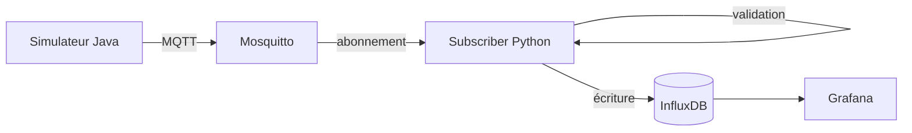

# Décisions d'architecture

Responsables : Youness (Data), Reda (Dev).

## 1. Broker MQTT : Mosquitto

Léger, simple à configurer, disponible en image Docker officielle. Il couvre tous nos besoins : QoS, messages retained, Last Will, authentification, ACL et TLS. EMQX apporte une console web et du clustering, inutiles pour ce projet.

## 2. Plateforme : Docker Compose, prêt pour le cloud

Toute la pile tourne avec Docker Compose (Mosquitto, InfluxDB, application Spring Boot, Grafana).

Le même `docker-compose.yml` peut être lancé sur n'importe quelle machine virtuelle Linux avec Docker, quel que soit le fournisseur. Le déploiement sur une VM demande d'ouvrir les ports nécessaires, d'activer l'authentification et TLS sur le broker, et de remplacer `localhost` par l'adresse de la VM. Une démonstration sur VM est prévue au sprint 4.

## 3. Modules de l'application Spring Boot

Une seule application découpée en packages :

```
com.iot.management
├── device/       enregistrement des objets, état online/offline
├── mqtt/         connexion MQTT, ingestion (abonnement), commandes (publication)
├── measurement/  stockage et lecture des mesures
├── command/      commandes envoyées aux actionneurs
├── security/     Spring Security, utilisateurs
└── config/       paramètres
```

## 4. Stockage

- **InfluxDB** : mesures (séries temporelles). Voir `DATA_MODEL.md`.
- **PostgreSQL** : appareils et utilisateurs.

## 5. Flux de données



1. Le simulateur publie les mesures sur `iot/{zone}/{deviceId}/{metric}` (voir `CONTRAT.md`).
2. Le subscriber Python s'abonne à `iot/+/+/+`. Les messages `status` (texte brut) servent au suivi online/offline. Chaque mesure est validée : JSON conforme, `deviceId` identique à celui du topic, valeur dans les plages du contrat. Les mesures invalides sont rejetées et journalisées, jamais écrites.
3. Les mesures valides sont écrites dans InfluxDB.
4. Grafana lit InfluxDB pour les tableaux de bord.

**Pourquoi InfluxDB :** les mesures IoT sont des séries temporelles. InfluxDB gère nativement les requêtes par fenêtre de temps (moyenne, min, max), la rétention automatique et l'intégration Grafana.

**Rétention :** 30 jours.

## 6. Sécurité (sprint 4)

Authentification du broker (identifiant et mot de passe), ACL par appareil, TLS, et Spring Security pour l'API.